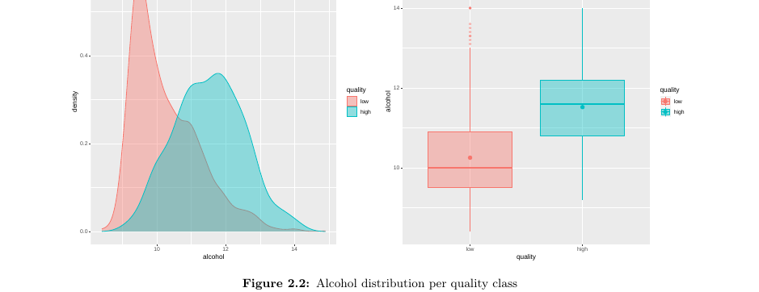

# How to pick good wine

The report asks whether physicochemical measurements can separate high-quality red Vinho Verde from low-quality wine, and which of the fitted classifiers has the highest held-out accuracy.

## Data

The fitted scripts read `data/winequality-red.csv` only. `data/winequality-white.csv` is in the repository and is not loaded.

The report's introduction describes the rows as green-wine samples of the red variety from the north of Portugal. `bib.bib` cites P. Cortez et al., Wine Quality Data Set, 2009, [UCI Wine Quality](https://archive.ics.uci.edu/ml/datasets/Wine+Quality). `data/winequality.txt` identifies the files as the red and white Vinho Verde samples from Cortez, Cerdeira, Almeida, Matos, and Reis, Decision Support Systems 47(4):547–553, 2009.

Section 2.1 of the report says the red table has 1599 observations, no missing values, and eleven chemical measurements. Quality is the median of at least three enologists' scores from 0 to 10. Scores 3–6 are recoded to `low` (1382 wines) and scores 7–8 to `high` (217 wines).

## Result

These figures are copied from the report that was built on 7 September 2020 and previously committed as `main.pdf`. They are not from a new `make report`. That build did not set a seed. This repository now calls `set.seed(2020)` once, at the end of `libraries.R`, and pins current package versions, so a new build will not reproduce the percentages below.

The highest test accuracy in Table 3.1 (section 3.0.6), also stated in section 3.0.3, is **84.95%** for the radial support vector machine on the filtered dataset.

The report does not publish an interval for that number. Table 3.1 and the model sections print one test-set percentage each. They do not print a cross-validation mean, a fold standard deviation, or a confidence interval. That gap is recorded in `openspec/changes/uncertainty` and is not implemented here.

| Recipe | Logistic | SVM polynomial | SVM radial | LDA | FDA |
| --- | ---: | ---: | ---: | ---: | ---: |
| Filtered dataset | 83.7% | 80.56% | 84.95% | 82.45% | 83.39% |
| Standardised filtered dataset | 81.19% | 82.13% | 80.25% | 80.56% | 79.31% |
| Standardised filtered principal components | 81.5% | 80.56% | 79.94% | 80.88% | 81.5% |

Figure 2.2 of that report shows alcohol for the recoded quality classes. High-quality wines sit higher.



## Reproduce

`knitr.zsh` has been removed. Use:

```sh
make deps
make test
make report
```

`make deps` restores `renv.lock`. `make test` sources `libraries.R` and `utils/estimation/test_pipeline.R` (the helper defines `test_pipeline()` and does not fit the grid). `make report` knits `main.Rnw` and compiles `main.pdf` with pdflatex. `make clean` removes the PDF and LaTeX intermediates.

If `results/classification_and_discrimination_fits.Rda` already exists, the classification chunk loads it and does not refit.
